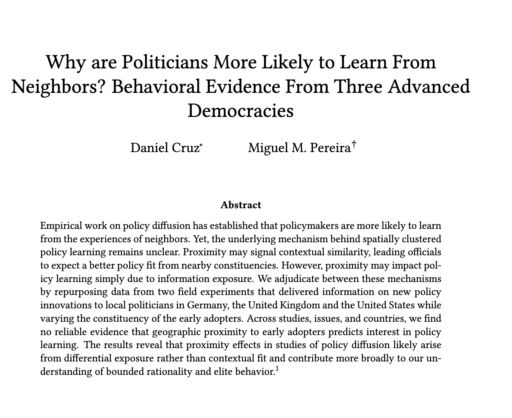

---

##### Download

+ [Paper](paper3.pdf)

---

#### Abstract

Empirical work on policy diffusion has established that policymakers are more likely to learn from the experiences of neighboring jurisdictions. Yet, the underlying mechanism behind spatially clustered policy learning remains unclear. Proximity may signal contextual similarity, leading officials to expect a better policy fit from nearby constituencies. However, proximity may affect policy learning simply through information exposure. We adjudicate between these mechanisms by repurposing data from two field experiments that delivered new policy information to local politicians in Germany, the United Kingdom and the United States. The evidence consists of one randomized comparison in Germany, and observational analyses in all three countries. Across studies, issues, and countries, we find no reliable evidence that geographic proximity to early adopters predicts policy learning. The results are more consistent with information constraints driving proximity effects in studies of policy diffusion and contribute to our understanding of bounded rationality and elite behavior.

---

##### Table 1: The effects of receiving an invitation from a co-national peer politician

---

##### Citation

Cruz, D & Pereira, M.M. The Influence of Episodic Information on Political Elites: Evidence from Chile. Polit Behav (2025).

---

